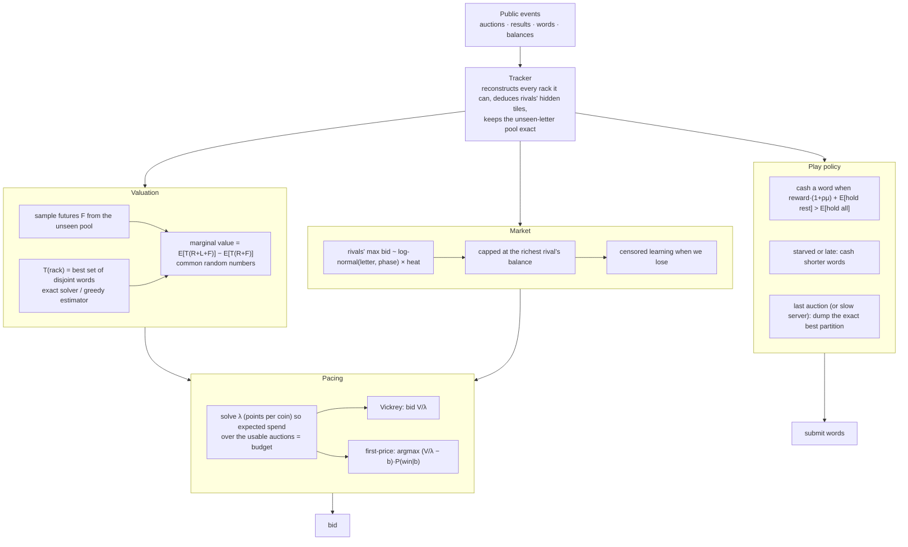
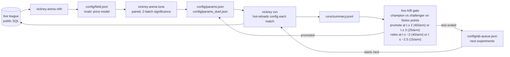

# Vickrey

> A sealed-bid word shark for [ScrabbleBot](https://scrabblebot.spacetimedb.com), the bot-vs-bot auction e-sport that SpacetimeDB runs at Cal Hacks 13.0. Written in Rust. It values every tile by Monte Carlo, paces its coins like an ad exchange, and tunes itself against the live league while it sleeps.

     

**Tags:** `scrabblebot` `spacetimedb` `rust` `auction-theory` `vickrey-auction` `monte-carlo` `game-ai` `bot` `cal-hacks` `self-improving`

Named for William Vickrey, the Nobel laureate whose second-price auction runs every round of this game. The bot it drives plays on the live league as **Karthik**.

> **Status: finished.** The project wrapped up after the Cal Hacks 13.0 tournament on October 25, 2026. The code stays public as a record; it is not maintained and does not accept contributions.

## How it ended

**Tournament:** 68 bots, four Swiss rounds at six-seat second-price tables, then a top-six knockout and a heads-up final. Karthik finished **49th** with 12 Swiss points (3rd, 4th, 5th and 4th at its four tables), scoring 66 to 76 per match against an 89 average in casual play. K-13 won, ahead of TileShark and Waupus.

**Casual league, after the last fixes:** about 360 matches, 27% wins (1 in 6 is break-even), half of them top-two finishes, average place 2.65 of 6.

**What worked**
- An instant *anchor* bid sent the moment an auction opens. Under server lag, bids that left with 800 ms to spare were rejected as late; ghost losses fell from 2.4 per match to 0.006.
- A connection health check that replaces a lagging connection, after playing out any near-finished rack first.
- Holding mid-match words worth under 45 points unless short of coins, which is what the league leaders do: +0.5 Swiss points per match and +66 to +70 points per heads-up game in paired simulation.

**What did not** (each lost to the champion in paired simulation against calibrated clones of the leaders): spending harder, premium-letter caps and a premium-coin reserve, cashing shorter words, earlier cash-ins, income-factor changes, volume floors at the market price, a longer premium valuation horizon, and Lala's completion floor.

**Why it was not enough:** the bot played close to its casual level; the top-six cut needed an average finish near 1.5. The winners model each rival individually and plan the whole match (several published their code after the tournament), while Vickrey bids against an average market. The simulator also rated Vickrey far stronger than live play did, which made many changes look safe that were not.

---

## The game in thirty seconds

Six bots each start a match with 100 coins and five hidden tiles. The server then reveals the rest of a 98-tile bag one letter at a time, and each letter gets a **one-second sealed-bid auction**: the highest bid wins and pays the runner-up's bid. Bots spell dictionary words from their tiles whenever they like. A word pays `face value × length multiplier` (1× up to three letters, rising to 3× at seven or more), and that reward goes into both your **score** and your **coin balance**. The match ends the moment the bag runs out.

## What actually decides matches

Before writing a line of code we read the server source end to end and mined the live league's public tables: 435 matches, about 29,500 auctions, and 7,600 words. These findings drive every design choice.

| Finding | Consequence |
|---|---|
| Bidding **never lowers your score**. Score is only word rewards, and coins left at the end are worthless. | This is a budget-pacing problem, not a profit problem. Spend everything, and spend it where points per coin are highest. |
| Against real bots a letter clears at **~12 coins** but is worth ~4.4 points. | Coins are the binding constraint. A 7-letter word is also a cash machine that buys the next one. |
| Prices start **~35% hot** and fall through the mid-game. Bots leave **~31 coins** unspent on average. | Patience is cheap. Late tiles that complete a word are bargains. |
| The match ends *inside* the transaction that closes the last auction. | The last tile is worthless (bid 0), and every word must be submitted while the last auction is open. |
| Opponents' balances are **public**. | The most anyone can bid is known exactly, so the price model is truncated there. |
| When you lose a heads-up auction, the price you see is **your own bid**. | That's a lower bound on the rival's bid, not a price, so it's learned as censored data. |
| The ENABLE wordlist has no `QI` or `ZA`. Q almost always needs U. | Valuation comes from the real dictionary, never from face value. |
| Tournaments: Swiss by place, then elimination, then a **heads-up three-game final** decided by total score. Admins can switch to first-price. | Separate parameter profiles for multi-seat and heads-up tables, plus surplus-maximising bid shading for first-price. |

## How Vickrey thinks



- **Terminal value `T(rack)`** is the best set of disjoint dictionary words a rack can play. That is exactly what the final dump scores. `vickrey-core` computes it with a trie over letter multisets and an anytime branch-and-bound solver. It is exact in about 9 ms for 20 letters, and a greedy estimator handles the Monte Carlo inner loop.
- **Valuation** samples the letters we can still expect to buy (sized by budget over market price) and measures what a tile adds, using common random numbers so the difference has low variance. A shrinkage prior steadies the cheap all-letters table.
- **Pacing** is the Balseiro–Gur idea from ad auctions: one shadow price `λ` turns points into coins, chosen so that expected spend matches budget plus expected word income. Under Vickrey the truthful bid `V/λ` is optimal.
- **Denial**: at heads-up tables the letter's value to the rival is added, since only the difference counts.
- **Safety rails**: never bid on the last tile, never bid above balance, a deterministic work budget caps every decision (p99 under 260 ms on one core), the final dump has its own deadline, and the dump moves earlier when the server is slow.

## Lessons from the live league

The Vickrey engine plays as bot **Karthik** for team **Karthik**. Within its first day in the live league it played 70+ real matches, won a third of them at 6-bot tables (where 1 in 6 is break-even), and climbed into the top ten of 59 bots by rating. The live league taught us three things the simulator couldn't:

| What went wrong live | Evidence | Fix |
|---|---|---|
| **Starving with money in the rack.** Vickrey went broke mid-match while holding a playable 5–6 letter word, then sat out 20–40 auctions. | m785 held JIVER through 38 dry auctions; m833 held GAUCHO; m816 held PIXELS. | Below 15 coins, with auctions still to come, cash words of 5+ letters, priced with μ (the marginal points a coin buys under the balance cap) rather than the pacing λ, which collapses exactly when you're broke. |
| **A slow shared server.** SpacetimeDB runs one database's reducers one at a time, and at hackathon peak calls took 1.8–4.3 s, so final dumps sent on the last auction landed after the match ended ("Match not running"). | Four straight last places with every final word rejected. | Track recent round trips and enter a dump zone when the time left is under `2·p90 + 0.3 s`. The bot cashes everything early, and keeps cashing whatever new letters complete. |
| **The price model was not the problem.** | 2,007 live bids: 401 predicted wins, 359 actual, calibrated in every band from 0.2 to 0.9. | We kept the model and fixed the strategy instead. |
| **…until the field changed.** The built-in curve assumed a cheap close; the live league runs hot late. | 16k winning bids over 236 matches: auctions 57–64 clear at 1.30–1.52× par, not 0.85×; σ is 0.35, not 0.42. | Refit the curve from live data (`vickrey-arena refit`, now on a timer) and let the pacer plan for the real ending. |
| **Score is coins converted, nothing else.** | Across 1,500 live seats, score ≈ 0.535 × coins spent (r = 0.88); every top bot converts at 0.50–0.54 points per coin. 6th place ends with 53 unspent coins. | Volume and timing are the whole game: endgame all-in bids, a rival-balance clamp so all-in is free against a broke table, and a premium-cap window so Q/Z/J/K/X are bought in the cheap fourth quarter, not at 41 coins in the first. |
| **We were the price-setting loser.** | 64% of valuable auctions we lost fed a rival's 7+ word; median shortfall 5 coins; we set the price as runner-up in 30% of losses. | A completion premium: bid over value when a letter turns the rack into a 7+ word now. Under Vickrey the premium is only ever paid when it wins. |
| **Our worst matches were lost to the server's clock, not to rivals.** | Bottom-two finishes averaged 8.3 "ghost losses" a match (we bid more than the price paid, 800+ ms to spare, and the server answered "Auction closed"); top-two finishes averaged 0.4. Word round trips in those minutes ran 650–1,566 ms: the reducer queue was a second behind, and whoever bid first won. | An anchor bid goes out the instant an auction opens (cached per-letter value over the last pacing multiplier, microseconds), and the full valuation replaces it while the auction is still open. First two live matches: 67 anchors each, mean 2.5 coins from the full bid, zero ghosts. |
| **Rivals come in fitted families, and two of them published their code.** | Refit on 1,568 matches: ramp bots (`−2.5 + 2.8·face + 15·progress + 11·balance/100`, hoard then spend late), flat bots (`7 + 2.75·face + 3·progress + 4.3·balance/100`, cash 5+ words on sight), face hunters (`4.4 + 3.94·face + …`). Nijello (bananatruck/scrabblebot-evo) and SookraBot (StephenSook/sookrabot) made their bidding formulas public on tournament eve. | All are simulator opponents (`ramp`, `flat`, `hunter`, `nijello`, `sookra`, `gaucho`), reproduced to the constant, so tuning happens against the exact field we face. |

## Self-improvement



`vickrey-arena evolve` refits the rivals' price model from the most recent all-real matches. It then hill-climbs both parameter profiles in the simulator, with the candidate and the incumbent at the same tables on the same seeds, and adopts a change only if it wins clearly on two independent batches. The live bot hot-reloads `config/` at the start of every match. The simulator can't model the strongest live bots, so the final word belongs to the league itself. **Live A/B testing** (`config/ab.json`) splits casual matches between the champion and a challenger, scores both arms on Swiss points, and promotes or retires the challenger once Welch's |t| ≥ 2 with 40+ matches per arm. Tournament matches always use the champion. `vickrey ab-report` shows the scoreboard.

Research is a standing loop too: every two hours agents re-profile the top rivals from the public tables and audit our own losses from telemetry, append dated sections to `runs/research/`, and queue any supported parameter change for the live gate; every six hours another agent re-checks competitors' public repos.

Evolution runs on a launchd timer locally and on a six-hourly GitHub Actions job that opens a PR with any improvement. The local timer stands down on battery and whenever a tournament is open or under way, so tuning never competes with live bids for the CPU. Heads-up tables (the three-game final) get their own profile, `config/params_duel.json`, tuned separately.

## Repo layout

| Crate | What it is |
|---|---|
| [`vickrey-core`](crates/vickrey-core) | Rules mirrored from the server, racks, the ENABLE dictionary indexed by multiset, and the partition solver |
| [`vickrey-brain`](crates/vickrey-brain) | `Tracker`, `Market`, `Brain`, `Params`: the whole strategy, with no I/O |
| [`vickrey-sim`](crates/vickrey-sim) | `vickrey-arena`: a server-faithful match engine, opponent archetypes (exact server sims, the starter kit, calibrated field bots), tournaments, the tuner, and the live-data refit |
| [`vickrey-bot`](crates/vickrey-bot) | `vickrey`: the SpacetimeDB client and autopilot (lobby, tournaments, telemetry, hot reload) |
| `config/` | Tuned params and the fitted field model |
| `ops/` | launchd agents, Dockerfile, binding regeneration |

## Run it

```sh
# 1. One-time: create the team and mint a bot credential.
#    Uses your `spacetime login`; no browser needed. (Ours: team Karthik, bot Karthik.)
cargo run --release -p vickrey-bot -- setup --team Karthik --bot Karthik

# 2. Play forever: joins lobbies, registers for tournaments, logs everything.
cargo run --release -p vickrey-bot -- run

# 3. Keep it alive across reboots and crashes (macOS), awake via caffeinate
ops/install-launchd.sh
ops/install-evolve.sh          # self-improvement every 3 h (skips on battery / during tournaments)

# What's going on?
cargo run --release -p vickrey-bot -- status
tail -f runs/vickrey.out.log    # every bid, play and dump, explained
cat runs/heartbeat             # liveness, current match, reconnects
```

## Simulate and tune

```sh
cargo build --release -p vickrey-sim
A=./target/release/vickrey-arena

$A bench --lineup vickrey,shark,shark,grinder,spender,nibbler -n 200   # vs the calibrated field
$A bench --lineup vickrey,shark -n 40                                   # heads-up final
$A --first-price bench --lineup vickrey,shark,shark,grinder,spender,nibbler -n 100
$A trace --lineup vickrey,shark --seed 3                                # every decision, explained
$A tournament --entrants vickrey,shark,shark,grinder,grinder,spender,nibbler,starter,shark,grinder,spender,nibbler -n 20
$A refit                                                               # field model from live data
$A evolve                                                              # refit + tune both profiles
```

## Engineering

- `cargo fmt`, `clippy -D warnings`, and the full test suite run in CI. The suite cross-checks the solver against brute force, checks server reward arithmetic against live rows, and checks tracker deduction, market monotonicity, and the engine's rules.
- **Strategy regression gates** fail the build if Vickrey's mean place slips at Vickrey or first-price tables, or against the server's own sim bots.
- Telemetry is append-only JSONL (`runs/`), documented in [`crates/vickrey-bot/TELEMETRY.md`](crates/vickrey-bot/TELEMETRY.md).

## License

MIT © Karthik Subramanian. The ENABLE wordlist in `data/` is public domain and is the exact list the ScrabbleBot module embeds.
